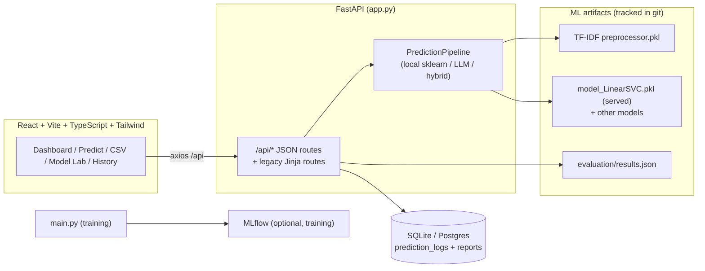

# Tweet Sentiment Classification and Topic Monitor

Three-class (negative / neutral / positive) sentiment classification, grown into a small monitoring platform:

- **Classify**: a trained scikit-learn model (optionally an LLM for uncertain texts), with word-level
  explanations and an "uncertain" answer when the model is unsure.
- **Monitor topics**: a worker collects public news about topics you register, classifies it, and shows
  trends, drift and statistical alerts.
- **Understand**: an LLM (optional) names the themes in the posts and writes a daily "what changed" note.
- **Ask**: an agent answers questions and writes reports from the stored posts, citing the posts it used.
- **Three UIs over one API**: server-rendered pages (`/`), a React app (`/app`) and a Streamlit demo.
- **Research track**: a leak-free evaluation, a gold-set pipeline and experiments (see *Evaluation*).

Work in progress: see *Known limitations* before quoting any number from this repository. The build plan is in
`docs/IMPLEMENTATION_PLAN.md`; hosting is in `docs/DEPLOYMENT.md`.

## Known limitations

- **The dataset labels are not human annotations.** `sentiment_analysis/dataset/thoroughly_cleaned_data.csv`
  (163k tweets, ~91% mention "modi") was labelled by a lexicon tool: TextBlob's `sign(polarity)` agrees
  with its labels on 99.98% of a 20,000-row random sample. Every accuracy / F1 in `artifacts/` therefore
  measures how well a model imitates that lexicon, **not** how well it detects human-perceived sentiment.
  A human-labelled evaluation set is planned.
- Use `artifacts/evaluation/results.csv` (one run, one leak-free split, with confidence intervals; see
  *Evaluation*). The older `artifacts/model_evaluation/` files mix results from different runs and splits
  and are superseded. The deployed `artifacts/model_trainer/*.pkl` models were trained on the older, leaky split.
- The train/val/test CSVs are generated, not committed: `python main.py` recreates them deterministically, and
  `artifacts/data_transformation/split_manifest.json` holds their sizes, label counts and fingerprints to verify them.
- The transformer tier is disabled until a fine-tuned 3-class checkpoint exists (see below).

- **News headlines are far from the training data.** The model learned from lexicon-labelled tweets, so its labels on
  news headlines are rough (a neutral price report can come out "positive"). The Topic Monitor page shows the
  unknown-word rate per topic as a warning sign, and the agent is told to mention this.
- **The LLM features have not been scored with a real model.** The agent evaluation harness
  (`python -m tweet_sentiment_classifier.app.agent.evaluation`) runs and its plumbing is tested with a scripted
  model, but no real-model results exist yet. The citation check removes invented post ids; it does not check
  that a number in an answer is right.

## How a prediction is made

`INFERENCE_MODE` (environment variable, default `local`) controls who decides:

| Mode | Behaviour |
|---|---|
| `local` | The trained scikit-learn model decides. No external API is called. |
| `llm` | An LLM (Hugging Face, then Groq) decides; if both fail the local model answers. |
| `hybrid` | The local model decides unless its confidence is below `HYBRID_CONFIDENCE_THRESHOLD` (0.75), then the LLM decides. |

Every response reports `decision_source` (for example `local:logisticregression` or
`llm:groq/llama-3.1-8b-instant`), the vote of each model that ran, and any `warnings`. LLM decisions have
no confidence (`null`). The optional transformer tier (`artifacts/model_trainer/model_DistilBERT`) is loaded
only if its `config.json` declares exactly 3 labels; it contributes a vote but does not decide.

When the linear local model decides, `contributions` lists the terms that pushed toward and against the
predicted label, with their character spans for highlighting (`null` for non-linear models and LLM
decisions). For the calibrated LinearSVC the weights are approximate; the ranking is what to read.

`ABSTAIN_THRESHOLD` (unset by default) turns local decisions below that confidence into `"uncertain"`.
Choose it on the validation split with
`python -m tweet_sentiment_classifier.evaluation.abstain --val <val.csv>`; the current model gives 0.7273
(86.9% of predictions kept, 97% agreement with the silver labels on those).

`POST /api/v1/corrections` stores a user's "wrong label" report in `label_corrections`. These rows are
candidates for annotation, never training labels.

## Topic monitoring, insights and the agent

```
worker: collect (Google News, optional RSS) -> classify -> trends, drift, alerts -> themes + daily note -> annotation queue
API:    /api/v1/...   topics, posts, trends, drift, alerts, insights, agent runs, annotation export, metrics
```

| What | Endpoint | Needs a key |
|---|---|---|
| Add / list / delete topics | `POST /api/v1/topics`, `GET /api/v1/topics`, `DELETE /api/v1/topics/{id}` | writes only when `API_AUTH=true` |
| Posts of a topic (filters, pages) | `GET /api/v1/topics/{id}/posts` | no |
| Trends with 95% intervals | `GET /api/v1/topics/{id}/trends` | no |
| Drift (unknown words, confidence, class mix) | `GET /api/v1/topics/{id}/drift` | no |
| Alerts, acknowledge | `GET /api/v1/topics/{id}/alerts`, `POST /api/v1/alerts/{id}/ack` | no |
| Themes and daily note | `GET /api/v1/topics/{id}/insights` | no |
| Collect now / rebuild insights | `POST /api/v1/topics/{id}/ingest`, `POST /api/v1/ingest/run`, `POST /api/v1/topics/{id}/insights/run` | **yes** |
| Agent (report, ask) | `POST /api/v1/agent/runs`, `GET /api/v1/agent/runs/{id}` | **yes** |
| Posts worth a human label | `GET /api/v1/annotation/queue`, `GET /api/v1/annotation/export` (Label Studio, no model labels) | refresh when `API_AUTH=true` |
| Prometheus metrics | `GET /metrics` | optional `METRICS_TOKEN` |

Keys go in the `X-API-Key` header (the older `X-Ingest-Token` header works too). The endpoints marked **yes** stay
closed (503) until you set `INGEST_TOKEN` or create a key:

```bash
python -m tweet_sentiment_classifier.app.core.auth create "my laptop"     # prints the key once; only its hash is stored
python -m tweet_sentiment_classifier.worker.main                          # collect + insights loop (or --once)
python -m tweet_sentiment_classifier.app.agent.evaluation --oracle        # harness plumbing check (no LLM)
python -m tweet_sentiment_classifier.app.agent.evaluation --out artifacts/agent_eval   # real model (needs a key)
```

Everything is optional and off by default; the main settings (full list in `.env.example`):

| Setting | Effect |
|---|---|
| `INGEST_TOKEN`, `API_AUTH` | shared secret for protected endpoints; `API_AUTH=true` also protects topic writes |
| `GROQ_API_KEY` / `LLM_PROVIDER` + `LLM_MODEL` | turns on themes naming, the daily note and the agent (Groq, OpenAI or Anthropic) |
| `LLM_DAILY_TOKEN_BUDGET`, `AGENT_MAX_STEPS`, `AGENT_MAX_TOKENS` | hard limits on LLM spend |
| `ABSTAIN_THRESHOLD` | local answers below this confidence become "uncertain" |
| `RATE_LIMIT_PER_MINUTE`, `RATE_LIMIT_WRITE_PER_MINUTE`, `TRUST_PROXY` | per-client limits (0 = off) |
| `ALERT_*`, `THEME_WINDOW_HOURS`, `POST_RETENTION_DAYS` | alert sensitivity, theme window, how long posts are kept |

## Web application (React + FastAPI)

A React (Vite + TypeScript + Tailwind) dashboard consumes the FastAPI API. The backend also keeps
the original server-rendered (Jinja2/Alpine) UI; the React app is served at `/app` when built.

### Architecture



### Pages

| Page | What it shows |
|---|---|
| Dashboard | Total analysed, sentiment distribution (donut), hourly trends, recent predictions, live model status — all from `/api/analytics`, `/api/recent-logs`, `/api/model-info`. |
| Text Prediction | Submit text → predicted class, confidence (only when the model produces one), decision source, latency, per-model votes. |
| Batch CSV Analysis | Upload a CSV with a `text` column → per-row results, sentiment distribution, row errors, and a downloadable results CSV. |
| Model Lab | Real evaluation results: macro-F1 with CIs, accuracy, kappa, ECE, per-class F1, confusion matrices, latency, and pairwise comparisons. Silver vs gold clearly separated. |
| Prediction History | Persisted predictions, searchable, filterable by sentiment and date, paginated. |
| Topic Monitor | Add topics; per topic: posts per day, alerts (acknowledge), drift against the previous week, the collected posts (filter by label, paginated), themes and the daily note. "Collect now" and "Rebuild" need an API key. |
| Ask the Agent | Ask a question or request a research report; shows each tool the agent used, then the answer with the posts it cites. Citations the agent could not back are removed and reported. Needs an API key. |
| Annotation Queue | Posts the model was unsure about, most uncertain first; add a topic's unsure posts and download a Label Studio import file (text only, no model label). |

The API key for the protected actions is typed into the sidebar field. It is kept in `sessionStorage` (cleared when the
tab closes) and sent as `X-API-Key`. The field is hidden on narrow screens.

### API (JSON, for the frontend and any client)

| Method | Path | Purpose |
|---|---|---|
| GET | `/health` | Liveness probe. |
| POST | `/api/predict` | Predict one text (`{"text": "..."}`). |
| POST | `/api/upload-csv` | Batch classify a CSV (multipart `file`). |
| GET | `/api/analytics` | Totals, distribution, hourly trends, sentiment index. |
| GET | `/api/recent-logs?limit=` | Latest predictions. |
| GET | `/api/prediction-history?q=&sentiment=&start=&end=&page=&limit=` | Searchable/filterable history (with the original text). |
| GET | `/api/model-info` | Served model, inference mode, transformer status, label map. |
| GET | `/api/model-lab` | Full evaluation detail (silver + gold). |
| GET | `/api/experiments` | Single-run summary table. |
| GET | `/api/results` | Results-page data (silver, gold, seed study, disagreements). |
| POST | `/predict` | Legacy text prediction (query param). |
| POST | `/upload_csv` | Legacy CSV upload (with optional LLM report). |
| GET | `/monitoring` | Monitoring counters. |

CORS is configured for `localhost:5173/5174/8000`. The `/api/*` routes are read-only except for the
two predict/upload endpoints; they never expose stack traces (a global handler returns a generic 500).

### Example CSV schema

```csv
text,source
"I love this new policy, great step!",demo
"The service was fine, nothing special.",demo
"This is the worst experience ever.",demo
```

Only a `text` column is required; extra columns are ignored. Blank cells are skipped (not classified
as the word "nan"). Output download columns: `text, prediction, confidence, model_used`.

## Setup

Python 3.12. Dependencies are split by purpose in `requirements/`:

| File | For |
|---|---|
| `base.txt` | data handling, config, database |
| `api.txt` | web app (no ML frameworks) |
| `serve.txt` | production serving: adds PyTorch, transformers, LangChain, Postgres driver |
| `train.txt` | the training pipeline (TensorFlow, MLflow, XGBoost). Install in a **separate** environment from `serve.txt` |
| `eval.txt` | lexicon baselines (TextBlob, VADER) for the evaluation runner |
| `dev.txt` | tests and lint |

```powershell
# --- Backend (Python 3.12) ---
python -m venv .venv
.\.venv\Scripts\Activate.ps1
pip install -r requirements.txt          # = requirements/serve.txt (torch, transformers, LangChain, Postgres)
# For a lighter local setup without torch/LangChain, use:
#   pip install -r requirements/api.txt
Copy-Item .env.example .env             # all keys are optional in local mode (SQLite + local inference)
python -m alembic upgrade head          # create/migrate the DB schema (adds prediction_logs.text)
python app.py                           # API + legacy UI at http://127.0.0.1:8000
```

> If your local `.env` points at Postgres but you have no `psycopg2`, set `DATABASE_URL=sqlite:///./monitoring.db`
> (the `.env.example` default) so the backend starts on SQLite.

### Frontend (React)

```powershell
cd frontend
npm install
npm run dev        # dev server at http://localhost:5173/app (proxies /api to :8000)
npm run build      # production build -> frontend/dist (served by the backend at /app)
npm run typecheck  # tsc
npm test           # component tests (Vitest + Testing Library, API mocked)
```

Run the backend (`python app.py`) and the frontend (`npm run dev`) together. Open
`http://localhost:5173/app` in dev, or `http://localhost:8000/app` after building. The legacy Jinja
UI remains at `/`.

`.env` keys: `DATABASE_URL` (default `sqlite:///./monitoring.db`), `INFERENCE_MODE`, `GROQ_API_KEY`,
`HF_TOKEN`. Without LangChain/`GROQ_API_KEY` the app still starts; `/search-analysis` then returns 503.

Existing databases created by older versions need the migration:

```bash
alembic upgrade head
```

## Training pipeline

```bash
pip install -r requirements/train.txt        # in its own environment
python main.py
```

Stages: ingest, validate (writes `artifacts/data_validation/validated.csv`), transform and split, then
train and evaluate each model in `params.yaml` (MLflow logging) and pick the best by macro-F1.

## Docker

`docker compose up` starts the database, the web app (applies migrations first) and the worker; `--profile monitoring` adds Prometheus. Production settings, hosting and the security checklist are in `docs/DEPLOYMENT.md`.


```bash
export POSTGRES_PASSWORD='choose-one'         # required; compose refuses to start without it
docker compose up --build
```

The database listens on `127.0.0.1:5432` only. The image installs the CPU-only PyTorch build.

## Evaluation

One command scores every model on one test set, so all numbers share a run id, a test-set fingerprint and
a seed (models are fit from scratch; nothing is read from old pickles):

```bash
pip install -r requirements/base.txt -r requirements/eval.txt
python -m tweet_sentiment_classifier.evaluation.run --train artifacts/data_transformation/train.csv --test artifacts/data_transformation/test.csv --out artifacts/evaluation
```

It writes `results.csv` / `results.json` (rebuilt from scratch each run) with accuracy, macro-F1 with a
95% bootstrap CI, Cohen's kappa, expected calibration error, per-class F1 and per-text latency, and reports
how many test texts also occur in the training file. Baselines: majority class, TextBlob, VADER.
**Read TextBlob's score as a check on the labels, not as a competitor**: it generated them.

Current silver results (`artifacts/evaluation/results.csv`, 31,917 test tweets, 0% train/test text overlap,
hyperparameters tuned on the validation split, see `tuning.json`):

| Model | Macro-F1 [95% CI] |
|---|---|
| TextBlob (label source) | 0.9997 [0.9994, 0.9998] |
| LinearSVC (served) | 0.9347 [0.9319, 0.9372] |
| LogisticRegression | 0.9262 [0.9231, 0.9288] |
| RidgeClassifier | 0.9014 [0.8981, 0.9046] |
| MultinomialNB | 0.7448 [0.7396, 0.7495] |
| VADER | 0.5518 [0.5463, 0.5568] |
| Majority | 0.2053 [0.2035, 0.2069] |

Over 5 different random splits (`seed_study.csv`) the standard deviation of macro-F1 is 0.002 to 0.003 for
every trained model, so gaps larger than about 0.01 are not split noise. `comparisons.csv` has paired-bootstrap
and McNemar tests (Holm-adjusted) for every pair; the bootstrap p-values are floored at 1/1001, so their
Holm-adjusted floor is 0.015. These are **silver** results: agreement with TextBlob, not with people. The
`/results` page shows them next to the gold results once the human-labelled set exists.

### Research workflow (gold set and experiments)

```bash
python -m tweet_sentiment_classifier.gold.sample --pilot                 # 1. pilot sample for annotators
python -m tweet_sentiment_classifier.gold.agreement data/gold/ann_a.csv data/gold/ann_b.csv   # 2. alpha
python -m tweet_sentiment_classifier.gold.sample --exclude data/gold/pilot_private.csv         # 3. full sample
python -m tweet_sentiment_classifier.gold.adjudicate --primary data/gold/ann_a.csv data/gold/ann_b.csv --tiebreak data/gold/ann_c.csv
python -m tweet_sentiment_classifier.gold.freeze                          # 4. gold_test / gold_train_pool
python -m tweet_sentiment_classifier.evaluation.run --train artifacts/data_transformation/train.csv --test data/gold/gold_test.csv --out artifacts/evaluation/gold --label-source gold --weights-column sampling_weight
python -m tweet_sentiment_classifier.experiments.gold_budget             # 5. experiments (see each module's --help)
python -m tweet_sentiment_classifier.experiments.cleanlab_run --eval gold=data/gold/gold_test.csv
python -m tweet_sentiment_classifier.experiments.report --gold artifacts/evaluation/gold/results.json --budget artifacts/experiments/gold_budget/results.json
```

Annotators follow `docs/annotation_guidelines.md` (draft; review it before the pilot). Fine-tuning
(`models/finetune.py`) needs a GPU for the full training split; LLM evaluation needs `GROQ_API_KEY`.

## Tests

```bash
pip install -r requirements/dev.txt
python -m pytest
```

CI runs the same command. `tests/test_transformer_inference.py` additionally needs the serving
environment (`requirements/serve.txt`) and is skipped otherwise.


## Troubleshooting

| Symptom | Fix |
|---|---|
| `ModuleNotFoundError: No module named 'psycopg'` on startup | Your `.env` sets a Postgres URL. Either install `requirements/serve.txt`, or use SQLite: set `DATABASE_URL=sqlite:///./monitoring.db`. |
| `Pipeline not initialized (models missing)` on `/predict` | The model artifacts are missing. They are tracked in git, so `git checkout -- artifacts` restores them. Re-run `python main.py` to rebuild. |
| React dev page shows "Backend unreachable" | Start the backend first (`python app.py`) so the Vite proxy at `:8000` is reachable. |
| `/app` returns 404 after `python app.py` | The frontend is not built yet. Run `npm run build` in `frontend/` (serves `frontend/dist` at `/app`). For dev, use `npm run dev` at `:5173/app`. |
| Prediction History shows `text not stored` for old rows | Rows logged before the `text` column was added have `NULL` text. New predictions store it. Run `alembic upgrade head` to add the column to an existing DB. |
| `npm: command not found` | Install Node.js 18+ (LTS). This project was verified on Node 22 / npm 10. |
| Confidence is `null` / "not reported" | That is correct for LLM decisions (INFERENCE_MODE=llm/hybrid). Local models always report a probability. |
| Model Lab shows only silver results | Gold (human-labelled) results appear only after the gold-set workflow in *Research workflow* is completed. Silver metrics are TextBlob-labelled by design (see *Known limitations*). |
